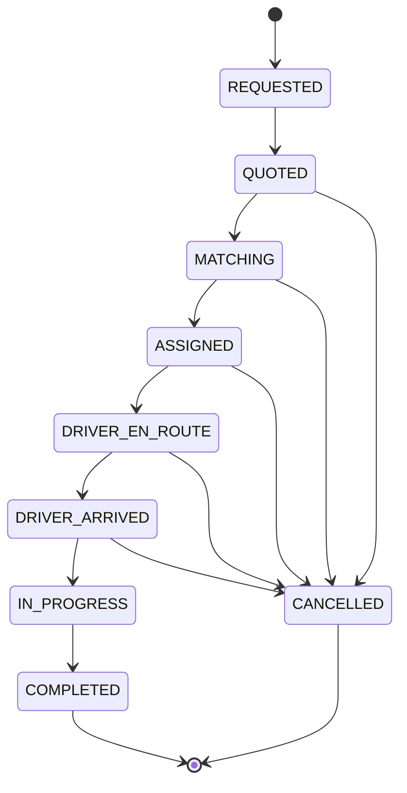
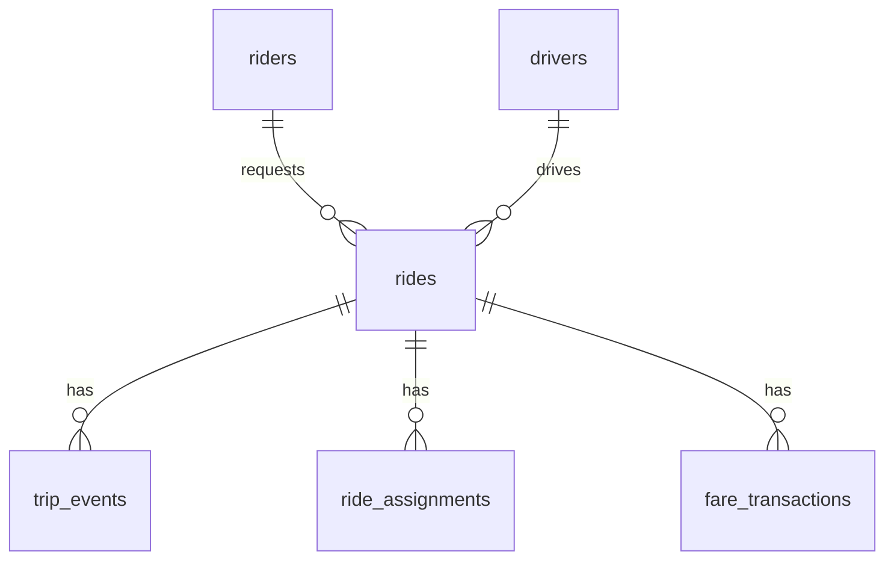

# Ride Engine: Real-Time Geospatial Matching & Dynamic Pricing


A simulation of a ride-hailing platform. Drivers stream GPS positions, riders request trips, the city is divided into Uber H3 hexagons, surge pricing is computed per hexagon (smoothed across neighbors and over time), and riders are matched to drivers in batches by solving a global assignment problem. A live React dashboard shows everything on a map.

**Live demo:** _add your Vercel URL here_ (the backend sleeps when idle; the first load can take about a minute)


> This is an engineering/simulation project, not a production ride-hailing platform. See [Known limitations](#known-limitations).

## Project Overview

Problems this project addresses:

- **First-come-first-served matching** gives the first rider the nearest driver and can strand the next rider far away. Batch matching minimises total pickup cost instead.
- **Price cliffs between neighbouring zones** invite gaming. Surge is smoothed across neighbouring hexagons and over time.
- **Database write amplification**: GPS pings go to Redis only. PostgreSQL stores durable business history.

## Architecture

```mermaid
flowchart LR
  SIM[Built-in simulation<br/># Ride Engine: Real-Time Geospatial Matching & Dynamic Pricing


A simulation of a ride-hailing platform. Drivers stream GPS positions, riders request trips, the city is divided into Uber H3 hexagons, surge pricing is computed per hexagon (smoothed across neighbors and over time), and riders are matched to drivers in batches by solving a global assignment problem. A live React dashboard shows everything on a map.

**Live demo:** _add your Vercel URL here_ (the backend sleeps when idle; the first load can take about a minute)


> This is an engineering/simulation project, not a production ride-hailing platform. See [Known limitations](#known-limitations).

## Project Overview

Problems this project addresses:

- **First-come-first-served matching** gives the first rider the nearest driver and can strand the next rider far away. Batch matching minimises total pickup cost instead.
- **Price cliffs between neighbouring zones** invite gaming. Surge is smoothed across neighbouring hexagons and over time.
- **Database write amplification**: GPS pings go to Redis only. PostgreSQL stores durable business history.

## Architecture

```mermaid
flowchart LR
  SIM[Built-in simulation<br/>drivers + riders] -->|GPS pings, ride requests| SVC
  UI[React dashboard<br/>MapLibre] <-->|REST + WebSocket| API[FastAPI]
  API --> SVC[Services]
  SVC --> H3[H3 spatial service]
  SVC <--> R[(Redis<br/>live state)]
  SVC --> DB[(PostgreSQL / SQLite<br/>history)]
  W[Background workers<br/>surge, matching, trips, stale sweeper] --> SVC
  SVC -->|events| BUS[Event bus] --> API
```

More diagrams and data flow: [docs/architecture.md](docs/architecture.md).

## Technology Stack

- **Backend:** Python 3.12+, FastAPI, Uvicorn, Pydantic v2, SQLAlchemy 2 (async), Alembic
- **Spatial:** Uber H3 (`h3` Python and `h3-js`)
- **Optimisation:** SciPy `linear_sum_assignment` (Hungarian algorithm), NumPy
- **State:** Redis (async client; in-memory `fakeredis` for zero-setup runs)
- **Database:** PostgreSQL via asyncpg; SQLite for local runs
- **Frontend:** React 18, TypeScript, Vite, MapLibre GL JS, native WebSocket
- **Infra:** Docker, Docker Compose, GitHub Actions

## Folder Structure

```text
backend/app/
  api/v1/        route handlers (thin: no business logic)
  algorithms/    surge engine, matching, ride state machine (pure functions/classes)
  core/          config, Redis/DB factories, event bus, service container
  models/        SQLAlchemy models
  schemas/       Pydantic request/response models
  services/      driver, ride, quote, fare, surge, matching, trip, stats, simulation
  simulation/    in-process fleet and demand generators
  spatial/       H3 service and distance helpers
  websocket/     dashboard WebSocket endpoint
  workers/       periodic background loops, trip simulator
backend/alembic/ database migrations
backend/tests/   unit, integration and end-to-end tests
frontend/src/    components, hooks, API client, types
simulator/       standalone HTTP simulators and the load test
docs/            architecture and performance notes
```

## Running Locally

Prerequisites: Python 3.12+, Node 18+.

```bash
# backend
python -m venv backend/.venv
# Windows: backend\.venv\Scripts\activate     macOS/Linux: source backend/.venv/bin/activate
pip install -r backend/requirements.txt
cp .env.example .env
cd backend
python -m uvicorn app.main:app --reload

# frontend (second terminal)
cd frontend
npm install
npm run dev
```

Open http://localhost:5173 and press **Start**. API docs: http://localhost:8000/docs.
Set `SIMULATION_AUTOSTART=true` in `.env` to start the simulation automatically.

## Docker Setup

```bash
docker compose up --build
```

| Service | URL |
|---|---|
| Dashboard | http://localhost:5173 |
| API | http://localhost:8000 |
| Swagger | http://localhost:8000/docs |
| PostgreSQL | localhost:5432 (user `postgres`, password from `POSTGRES_PASSWORD`) |
| Redis | localhost:6379 |

The external load generator is optional: `docker compose --profile load up simulator`.

## Environment Variables

| Variable | Default | Meaning |
|---|---|---|
| `DATABASE_URL` | `sqlite+aiosqlite:///./rides.db` | Async database URL |
| `REDIS_URL` | `memory` | Redis URI, or `memory` for in-process fake |
| `AUTO_CREATE_TABLES` | `true` | `false` when Alembic manages the schema |
| `H3_RESOLUTION` | `8` | H3 resolution |
| `CITY_LAT` / `CITY_LNG` | `12.9716` / `77.5946` | City center (Bangalore) |
| `DRIVER_COUNT` | `100` | Simulated drivers |
| `GPS_UPDATE_INTERVAL` | `3` | Seconds between pings |
| `MATCHING_INTERVAL` | `5.0` | Seconds between matching batches |
| `MAX_PICKUP_DISTANCE_KM` | `5.0` | Max driver-rider distance |
| `SURGE_MIN` / `SURGE_MAX` | `1.0` / `4.0` | Surge bounds |
| `SURGE_ALPHA` | `0.3` | Temporal smoothing factor |
| `SURGE_LOCAL_WEIGHT` / `SURGE_NEIGHBOR_WEIGHT` | `0.7` / `0.3` | Spatial smoothing weights |
| `SURGE_SENSITIVITY` | `0.35` | How fast surge rises with demand |
| `BASE_FARE` / `PER_KM_RATE` / `PER_MINUTE_RATE` | `50` / `12` / `2` | Fare (INR) |
| `SIMULATION_SEED` | `42` | Reproducible randomness |
| `SIMULATION_AUTOSTART` | `false` | Start simulation at boot |
| `CORS_ORIGINS` | localhost:5173 | Allowed browser origins (comma separated) |

## API Documentation

Interactive docs at `/docs` (Swagger). Main endpoints:

| Method | Path | Purpose |
|---|---|---|
| GET | `/health` | Redis and database health |
| GET | `/api/v1/h3/locate?lat=&lng=` | Which H3 cell contains a point |
| POST | `/api/v1/drivers/location` | Ingest a GPS ping (Redis only) |
| GET | `/api/v1/drivers`, `/api/v1/drivers/{id}` | Driver state |
| POST | `/api/v1/rides/quote` | Price a trip without creating it |
| POST | `/api/v1/rides/request` | Create a ride (priced on creation) |
| GET | `/api/v1/rides/live`, `/api/v1/rides/{id}` | Live rides, one ride |
| GET | `/api/v1/rides/{id}/events` | Audit trail from the database |
| POST | `/api/v1/rides/{id}/cancel`, `/complete` | Lifecycle actions |
| GET | `/api/v1/zones`, `/api/v1/zones/{h3_id}` | Supply, demand, surge per hexagon |
| GET | `/api/v1/stats` | System-wide metrics |
| POST | `/api/v1/simulation/{start,pause,reset,demand,spike,drivers,params}` | Simulation controls |
| WS | `/ws/dashboard` | Live event stream |

Example quote:

```json
POST /api/v1/rides/quote
{"pickup": {"latitude": 12.9716, "longitude": 77.5946},
 "destination": {"latitude": 13.0, "longitude": 77.62}}

200 OK
{"pickup_h3": "8860145b49fffff", "supply": 12, "demand": 21, "distance_km": 5.1,
 "duration_min": 12.2, "base_fare": 50.0, "surge_multiplier": 1.35,
 "estimated_fare": 180.5, "currency": "INR"}
```

Errors: `422` invalid input (for example latitude 95), `400` malformed H3 id, `404` unknown driver/ride, `409` stale GPS update, duplicate open ride or invalid state transition.

## H3 Spatial Model

H3 covers the planet with hexagons. A coordinate maps to a cell id such as `8860145b49fffff`, and the same point always maps to the same id, so the id is a natural key in Redis.

- **Resolution 8** (default): measured average area about 0.76 km², edge about 0.53 km, neighbour centres about 0.9 km apart: roughly a neighbourhood.
- Every hexagon has exactly 6 equidistant neighbours, which makes neighbour smoothing uniform.
- **Border effect:** two drivers 10 metres apart can be in different cells. This is why surge is smoothed across neighbours.

## Surge Pricing Algorithm

Per cell, every few seconds (`SurgePricingEngine`):

1. `local_ratio = demand / max(supply, 1)`: no division by zero.
2. `neighbor_ratio` = mean ratio of the 6 neighbouring cells.
3. `effective = 0.7 * local + 0.3 * neighbor`.
4. `target = min + (max - min) * (1 - exp(-sensitivity * max(0, effective - 1)))`: stays at the minimum while supply covers demand, rises smoothly, saturates at the maximum.
5. `surge = alpha * target + (1 - alpha) * previous`: temporal smoothing, so prices climb and fall gradually.

Behaviour worth knowing: an isolated spike is damped by calm neighbours, and a calm cell next to hot cells is pulled up. A cell only gets a large surge from neighbours when the surrounding area is hot too. Quotes use the same formula without writing state. Surge history is stored in the database only when a cell's surge changes by at least 0.05.

## Matching Algorithm

Requests are buffered and matched every `MATCHING_INTERVAL` seconds:

1. Collect pending rides and available drivers.
2. **Candidate filtering:** each request keeps its K nearest drivers and each driver its K nearest requests, only within `MAX_PICKUP_DISTANCE_KM`.
3. **Cost:** `pickup_time_weight * ETA_min + distance_weight * km - wait_priority_weight * minutes_waited`.
4. Build a cost matrix over the filtered rows and columns; non-candidates get a huge cost.
5. Solve with the Hungarian algorithm (`linear_sum_assignment`): maximises the number of real matches first, then minimises total cost.
6. Claim drivers in Redis, persist assignments, publish events. Unmatched rides retry next batch and expire after 120 s.

Complexity: filtering is O(R x D) with NumPy; the Hungarian step is O(n³) on the filtered matrix. Tests prove that global matching gives a different and cheaper assignment than nearest-driver-first.

Limitations: straight-line distances (no road network); the K-nearest limit can occasionally leave a feasible far driver unused; one matching process, no distributed locking.

## Ride State Machine



Invalid transitions raise an error (HTTP 409). A started trip cannot be cancelled.

## Redis Data Model

| Key | Type | Content |
|---|---|---|
| `driver:{id}` | hash | latitude, longitude, h3_cell, status, last_updated, trip_id |
| `drivers:all` | set | all driver ids |
| `cell:{h3}:drivers` | set | drivers in the cell |
| `cell:{h3}:available` | set | available drivers (supply) |
| `cell:{h3}:requests` | set | open ride requests (demand) |
| `zone:{h3}` | hash | surge, ratios, supply, demand, updated_at |
| `zones:active`, `zones:priced` | sets | cells with activity / with a price |
| `ride:{id}` | hash | one ride |
| `rides:open`, `rides:active` | sets | waiting rides / assigned rides |
| `rider:{id}:open_ride` | string | lock: one open ride per rider |
| `stats` | hash | counters for the dashboard |

H3 cell sets are used instead of Redis GEO: "available drivers in this hexagon" is one `SCARD`, and it uses the same index as the pricing logic.

## PostgreSQL Schema



Tables: `drivers`, `riders`, `rides`, `ride_assignments`, `trip_events` (audit log), `fare_transactions`, `surge_history`, `driver_location_history` (model only; GPS pings are never written per update). Migrations: `backend/alembic`.

## WebSocket Events

Endpoint `/ws/dashboard`. On connect the server sends a `snapshot` (all drivers); after that only small incremental events:

| Event | Data |
|---|---|
| `snapshot` | `drivers[]` |
| `driver_location_updated` | driver_id, latitude, longitude, h3_cell, status |
| `driver_removed`, `simulation_reset` | driver_id / empty |
| `ride_requested` | the ride |
| `ride_status_changed` | ride_id, from, to |
| `driver_assigned` | ride_id, driver_id, pickup_eta_seconds |
| `surge_updated` | zones[] that changed |

Envelope: `{"event": "...", "timestamp": "ISO-8601", "data": {...}}`. The dashboard reconnects with backoff and resyncs from the snapshot.

## Simulation

The backend runs a built-in simulation (wandering drivers, Poisson ride demand, hotspots). The dashboard buttons start, pause and reset it, change demand, add or remove drivers, trigger a demand spike and change matching interval and surge sensitivity. `SIMULATION_SEED` makes runs reproducible. Standalone HTTP simulators are in `simulator/`.

## Testing

```bash
cd backend && python -m pytest -v
cd frontend && npm run build
```

Covers H3 conversion and neighbours, distances, surge formula and smoothing, fares, matching (including global vs nearest-first), state transitions, Redis-backed services, API endpoints, WebSocket snapshot/events/reconnect, Alembic migrations, a full-lifecycle integration test and an API end-to-end test. CI runs these on every push.

## Performance

See [docs/performance.md](docs/performance.md) for how to run the load test and for measured results. No production-scale claims are made beyond what is measured there.

## Deployment

Backend on Render (free web service, in-memory Redis, SQLite), frontend on Vercel. See the deployment notes in the repo's `render.yaml` and below.

Free-tier caveats: the service sleeps when idle and wakes in about a minute; its filesystem is ephemeral, so database history and Redis state reset on restart; the simulation autostarts again.

## Troubleshooting

- **White page in the dashboard:** a source file is missing or empty; check the browser console (F12).
- **"reconnecting" badge:** backend not running or `VITE_API_URL` wrong.
- **CORS error in the console:** add the frontend URL to `CORS_ORIGINS` on the backend.
- **`ModuleNotFoundError: app`:** run pytest from `backend`, or from the root (a root `pytest.ini` exists).
- **`uvicorn` not found:** the virtual environment is not active.

## Known Limitations

- Simulation only: no authentication, payments, real maps or road routing.
- Single backend process; Redis state is lost on restart when using in-memory Redis.
- Debug endpoints (`match-now`, `trip-tick`, simulation controls) are unauthenticated.
- Driver location history is modelled but not written.
- Docker files are provided but were not verified on the author's machine.

## Future Improvements

Road-network routing (OSRM), sampled GPS history writer, distributed matching with leader election, authentication, load-tested scaling to thousands of drivers, Prometheus metrics.drivers + riders] -->|GPS pings, ride requests| SVC
  UI[React dashboard<br/>MapLibre] <-->|REST + WebSocket| API[FastAPI]
  API --> SVC[Services]
  SVC --> H3[H3 spatial service]
  SVC <--> R[(Redis<br/>live state)]
  SVC --> DB[(PostgreSQL / SQLite<br/>history)]
  W[Background workers<br/>surge, matching, trips, stale sweeper] --> SVC
  SVC -->|events| BUS[Event bus] --> API
More diagrams and data flow: docs/architecture.md.Technology StackBackend: Python 3.12+, FastAPI, Uvicorn, Pydantic v2, SQLAlchemy 2 (async), AlembicSpatial: Uber H3 (h3 Python and h3-js)Optimisation: SciPy linear_sum_assignment (Hungarian algorithm), NumPyState: Redis (async client; in-memory fakeredis for zero-setup runs)Database: PostgreSQL via asyncpg; SQLite for local runsFrontend: React 18, TypeScript, Vite, MapLibre GL JS, native WebSocketInfra: Docker, Docker Compose, GitHub ActionsFolder StructurePlaintextbackend/app/
  api/v1/        route handlers (thin: no business logic)
  algorithms/    surge engine, matching, ride state machine (pure functions/classes)
  core/          config, Redis/DB factories, event bus, service container
  models/        SQLAlchemy models
  schemas/       Pydantic request/response models
  services/      driver, ride, quote, fare, surge, matching, trip, stats, simulation
  simulation/    in-process fleet and demand generators
  spatial/       H3 service and distance helpers
  websocket/     dashboard WebSocket endpoint
  workers/       periodic background loops, trip simulator
backend/alembic/ database migrations
backend/tests/   unit, integration and end-to-end tests
frontend/src/    components, hooks, API client, types
simulator/       standalone HTTP simulators and the load test
docs/            architecture and performance notes
Running LocallyPrerequisites: Python 3.12+, Node 18+.Bash# backend
python -m venv backend/.venv
# Windows: backend\.venv\Scripts\activate     macOS/Linux: source backend/.venv/bin/activate
pip install -r backend/requirements.txt
cp .env.example .env
cd backend
python -m uvicorn app.main:app --reload

# frontend (second terminal)
cd frontend
npm install
npm run dev
Open http://localhost:5173 and press Start. API docs: http://localhost:8000/docs.Set SIMULATION_AUTOSTART=true in .env to start the simulation automatically.Docker SetupBashdocker compose up --build
ServiceURLDashboardhttp://localhost:5173APIhttp://localhost:8000Swaggerhttp://localhost:8000/docsPostgreSQLlocalhost:5432 (user postgres, password from POSTGRES_PASSWORD)Redislocalhost:6379The external load generator is optional: docker compose --profile load up simulator.Environment VariablesVariableDefaultMeaningDATABASE_URLsqlite+aiosqlite:///./rides.dbAsync database URLREDIS_URLmemoryRedis URI, or memory for in-process fakeAUTO_CREATE_TABLEStruefalse when Alembic manages the schemaH3_RESOLUTION8H3 resolutionCITY_LAT / CITY_LNG12.9716 / 77.5946City center (Bangalore)DRIVER_COUNT100Simulated driversGPS_UPDATE_INTERVAL3Seconds between pingsMATCHING_INTERVAL5.0Seconds between matching batchesMAX_PICKUP_DISTANCE_KM5.0Max driver-rider distanceSURGE_MIN / SURGE_MAX1.0 / 4.0Surge boundsSURGE_ALPHA0.3Temporal smoothing factorSURGE_LOCAL_WEIGHT / SURGE_NEIGHBOR_WEIGHT0.7 / 0.3Spatial smoothing weightsSURGE_SENSITIVITY0.35How fast surge rises with demandBASE_FARE / PER_KM_RATE / PER_MINUTE_RATE50 / 12 / 2Fare (INR)SIMULATION_SEED42Reproducible randomnessSIMULATION_AUTOSTARTfalseStart simulation at bootCORS_ORIGINSlocalhost:5173Allowed browser origins (comma separated)API DocumentationInteractive docs at /docs (Swagger). Main endpoints:MethodPathPurposeGET/healthRedis and database healthGET/api/v1/h3/locate?lat=&lng=Which H3 cell contains a pointPOST/api/v1/drivers/locationIngest a GPS ping (Redis only)GET/api/v1/drivers, /api/v1/drivers/{id}Driver statePOST/api/v1/rides/quotePrice a trip without creating itPOST/api/v1/rides/requestCreate a ride (priced on creation)GET/api/v1/rides/live, /api/v1/rides/{id}Live rides, one rideGET/api/v1/rides/{id}/eventsAudit trail from the databasePOST/api/v1/rides/{id}/cancel, /completeLifecycle actionsGET/api/v1/zones, /api/v1/zones/{h3_id}Supply, demand, surge per hexagonGET/api/v1/statsSystem-wide metricsPOST/api/v1/simulation/{start,pause,reset,demand,spike,drivers,params}Simulation controlsWS/ws/dashboardLive event streamExample quote:JSONPOST /api/v1/rides/quote
{"pickup": {"latitude": 12.9716, "longitude": 77.5946},
 "destination": {"latitude": 13.0, "longitude": 77.62}}

200 OK
{"pickup_h3": "8860145b49fffff", "supply": 12, "demand": 21, "distance_km": 5.1,
 "duration_min": 12.2, "base_fare": 50.0, "surge_multiplier": 1.35,
 "estimated_fare": 180.5, "currency": "INR"}
Errors: 422 invalid input (for example latitude 95), 400 malformed H3 id, 404 unknown driver/ride, 409 stale GPS update, duplicate open ride or invalid state transition.H3 Spatial ModelH3 covers the planet with hexagons. A coordinate maps to a cell id such as 8860145b49fffff, and the same point always maps to the same id, so the id is a natural key in Redis.Resolution 8 (default): measured average area about 0.76 km², edge about 0.53 km, neighbour centres about 0.9 km apart: roughly a neighbourhood.Every hexagon has exactly 6 equidistant neighbours, which makes neighbour smoothing uniform.Border effect: two drivers 10 metres apart can be in different cells. This is why surge is smoothed across neighbours.Surge Pricing AlgorithmPer cell, every few seconds (SurgePricingEngine):local_ratio = demand / max(supply, 1): no division by zero.neighbor_ratio = mean ratio of the 6 neighbouring cells.effective = 0.7 * local + 0.3 * neighbor.target = min + (max - min) * (1 - exp(-sensitivity * max(0, effective - 1))): stays at the minimum while supply covers demand, rises smoothly, saturates at the maximum.surge = alpha * target + (1 - alpha) * previous: temporal smoothing, so prices climb and fall gradually.Behaviour worth knowing: an isolated spike is damped by calm neighbours, and a calm cell next to hot cells is pulled up. A cell only gets a large surge from neighbours when the surrounding area is hot too. Quotes use the same formula without writing state. Surge history is stored in the database only when a cell's surge changes by at least 0.05.Matching AlgorithmRequests are buffered and matched every MATCHING_INTERVAL seconds:Collect pending rides and available drivers.Candidate filtering: each request keeps its K nearest drivers and each driver its K nearest requests, only within MAX_PICKUP_DISTANCE_KM.Cost: pickup_time_weight * ETA_min + distance_weight * km - wait_priority_weight * minutes_waited.Build a cost matrix over the filtered rows and columns; non-candidates get a huge cost.Solve with the Hungarian algorithm (linear_sum_assignment): maximises the number of real matches first, then minimises total cost.Claim drivers in Redis, persist assignments, publish events. Unmatched rides retry next batch and expire after 120 s.Complexity: filtering is O(R x D) with NumPy; the Hungarian step is O(n³) on the filtered matrix. Tests prove that global matching gives a different and cheaper assignment than nearest-driver-first.Limitations: straight-line distances (no road network); the K-nearest limit can occasionally leave a feasible far driver unused; one matching process, no distributed locking.Ride State MachineCode snippetstateDiagram-v2
  [*] --> REQUESTED
  REQUESTED --> QUOTED
  QUOTED --> MATCHING
  MATCHING --> ASSIGNED
  ASSIGNED --> DRIVER_EN_ROUTE
  DRIVER_EN_ROUTE --> DRIVER_ARRIVED
  DRIVER_ARRIVED --> IN_PROGRESS
  IN_PROGRESS --> COMPLETED
  QUOTED --> CANCELLED
  MATCHING --> CANCELLED
  ASSIGNED --> CANCELLED
  DRIVER_EN_ROUTE --> CANCELLED
  DRIVER_ARRIVED --> CANCELLED
  COMPLETED --> [*]
  CANCELLED --> [*]
Invalid transitions raise an error (HTTP 409). A started trip cannot be cancelled.Redis Data ModelKeyTypeContentdriver:{id}hashlatitude, longitude, h3_cell, status, last_updated, trip_iddrivers:allsetall driver idscell:{h3}:driverssetdrivers in the cellcell:{h3}:availablesetavailable drivers (supply)cell:{h3}:requestssetopen ride requests (demand)zone:{h3}hashsurge, ratios, supply, demand, updated_atzones:active, zones:pricedsetscells with activity / with a priceride:{id}hashone riderides:open, rides:activesetswaiting rides / assigned ridesrider:{id}:open_ridestringlock: one open ride per riderstatshashcounters for the dashboardH3 cell sets are used instead of Redis GEO: "available drivers in this hexagon" is one SCARD, and it uses the same index as the pricing logic.PostgreSQL SchemaCode snippeterDiagram
  riders ||--o{ rides : requests
  drivers ||--o{ rides : drives
  rides ||--o{ trip_events : has
  rides ||--o{ ride_assignments : has
  rides ||--o{ fare_transactions : has
Tables: drivers, riders, rides, ride_assignments, trip_events (audit log), fare_transactions, surge_history, driver_location_history (model only; GPS pings are never written per update). Migrations: backend/alembic.WebSocket EventsEndpoint /ws/dashboard. On connect the server sends a snapshot (all drivers); after that only small incremental events:EventDatasnapshotdrivers[]driver_location_updateddriver_id, latitude, longitude, h3_cell, statusdriver_removed, simulation_resetdriver_id / emptyride_requestedthe rideride_status_changedride_id, from, todriver_assignedride_id, driver_id, pickup_eta_secondssurge_updatedzones[] that changedEnvelope: {"event": "...", "timestamp": "ISO-8601", "data": {...}}. The dashboard reconnects with backoff and resyncs from the snapshot.SimulationThe backend runs a built-in simulation (wandering drivers, Poisson ride demand, hotspots). The dashboard buttons start, pause and reset it, change demand, add or remove drivers, trigger a demand spike and change matching interval and surge sensitivity. SIMULATION_SEED makes runs reproducible. Standalone HTTP simulators are in simulator/.TestingBashcd backend && python -m pytest -v
cd frontend && npm run build
Covers H3 conversion and neighbours, distances, surge formula and smoothing, fares, matching (including global vs nearest-first), state transitions, Redis-backed services, API endpoints, WebSocket snapshot/events/reconnect, Alembic migrations, a full-lifecycle integration test and an API end-to-end test. CI runs these on every push.PerformanceSee docs/performance.md for how to run the load test and for measured results. No production-scale claims are made beyond what is measured there.DeploymentBackend on Render (free web service, in-memory Redis, SQLite), frontend on Vercel. See the deployment notes in the repo's render.yaml and below.Free-tier caveats: the service sleeps when idle and wakes in about a minute; its filesystem is ephemeral, so database history and Redis state reset on restart; the simulation autostarts again.TroubleshootingWhite page in the dashboard: a source file is missing or empty; check the browser console (F12)."reconnecting" badge: backend not running or VITE_API_URL wrong.CORS error in the console: add the frontend URL to CORS_ORIGINS on the backend.ModuleNotFoundError: app: run pytest from backend, or from the root (a root pytest.ini exists).uvicorn not found: the virtual environment is not active.Known LimitationsSimulation only: no authentication, payments, real maps or road routing.Single backend process; Redis state is lost on restart when using in-memory Redis.Debug endpoints (match-now, trip-tick, simulation controls) are unauthenticated.Driver location history is modelled but not written.Docker files are provided but were not verified on the author's machine.Future ImprovementsRoad-network routing (OSRM), sampled GPS history writer, distributed matching with leader election, authentication, load-tested scaling to thousands of drivers, Prometheus metrics.
