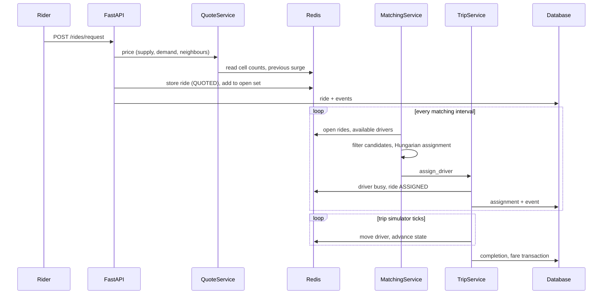

# Architecture notes

## Ride flow

## Background workers

| Worker | Interval | Job |
|---|---|---|
| stale sweeper | 10 s | mark silent drivers `stale`, remove from supply |
| surge | 5 s | recompute surge for active cells and neighbours, store history |
| matching | 5 s (adjustable) | one matching batch, expire old requests |
| trips | 1 s | move assigned drivers, advance trip states |
| simulation fleet / demand | 3 s / 1 s | built-in drivers and riders |

## Design decisions

- **Redis for live state, database for history.** A GPS ping touches only Redis.
- **H3 cell sets instead of Redis GEO.** One index serves counting, pricing and candidate lookup.
- **Pure algorithm modules.** Surge, matching and the state machine take plain values, so they are unit tested without Redis or a database.
- **One service container** builds all services; the app and the tests share it.
- **In-process event bus** feeds the WebSocket hub. With several backend instances this would need Redis pub/sub.
- **Busy drivers are moved by the trip simulator**; outside GPS pings only refresh their heartbeat. This is a simulation shortcut.